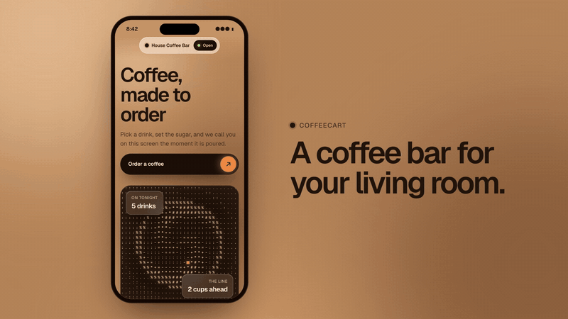
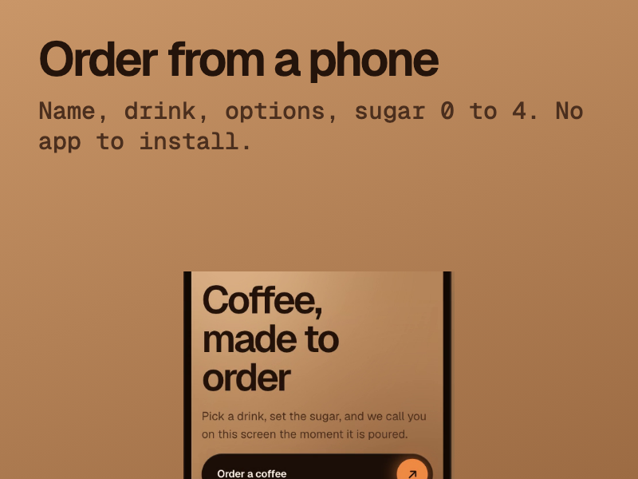
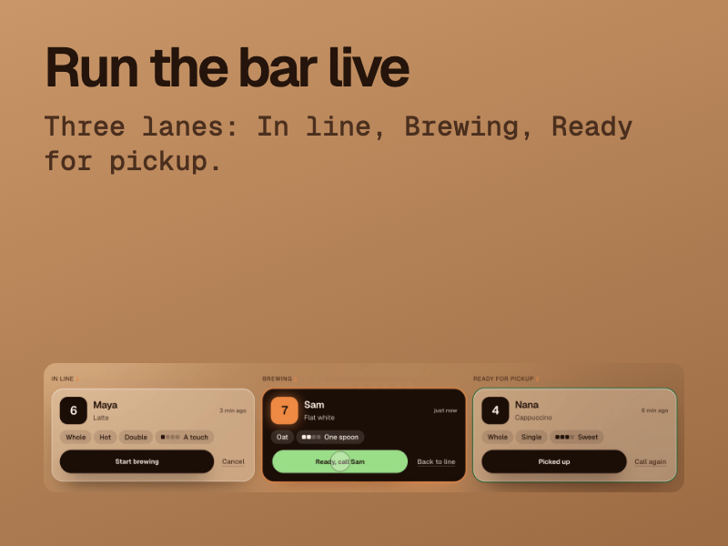
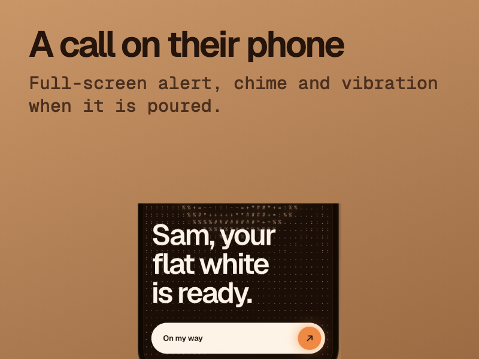
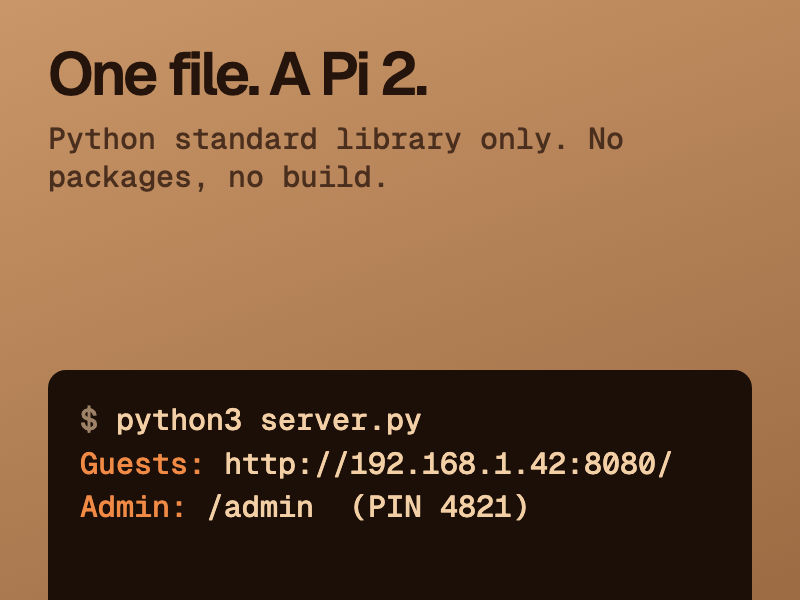

<a id="readme-top"></a>

<p align="center">
  <a href="#-demo"></a>
</p>

<p align="center">
  <strong>A coffee ordering system for when friends and family come over.</strong><br>
  Guests order from their phone. You run the bar from <code>/admin</code>. Their phone calls them when the cup is ready.
</p>

<p align="center">
  
  
  
</p>

<p align="center">
  <a href="#-demo">Demo</a> ·
  <a href="#-whats-in-it">Features</a> ·
  <a href="#-run-it">Run it</a> ·
  <a href="#-on-the-raspberry-pi">Raspberry Pi</a> ·
  <a href="#-good-to-know">Good to know</a> ·
  <a href="#-files">Files</a>
</p>


## 🎬 Demo

<p align="center">
  <a href="brag-output/brag.mp4"></a>
  <br>
  <sub>▶ Click for the full 22-second launch video with sound.</sub>
</p>

It's built to run on a Raspberry Pi 2: one Python file using only the standard library, plain HTML/CSS/JS, and no build step or packages to install.

## ✨ Features

<p align="center">
  
  
  
  
</p>


## ☕ What's in it

**Guests** (`http://<pi>:8080/`)

- Name, drink, options (milk, temperature, shots…), a sugar level from 0 to 4, and notes
- A live ticket with their order number, place in line, and progress (In line → Brewing → Ready)
- The whole queue, with their own order highlighted
- A full-screen "your coffee is ready" alert with a chime, vibration and a flashing tab title
- Can cancel an order until you start making it

**You** (`http://<pi>:8080/admin`, PIN protected)

- Live board in three lanes: In line → Brewing → Ready for pickup
- **Ready, call Sam** notifies the guest; **Call again** re-alerts anyone who hasn't come up yet

- A chime when a new order comes in
- Menu: add, edit, or remove drinks, choose which options each one offers, and switch drinks on or off when you run out
- Options: edit the option groups (Milk, Temperature, Shots, add Syrup…)
- An open/closed switch, the bar's name, and the PIN

## 🚀 Run it

```bash
python3 server.py
```

It prints the guest link and the admin PIN:

```
  Guests:  http://192.168.1.42:8080/
  Admin:   http://192.168.1.42:8080/admin   (PIN 4821)
```

Set your own PIN with `COFFEE_PIN=1234 python3 server.py`, or change it in Admin → Settings. To use a different port, set `PORT=80`. Everything (menu, orders, settings) is saved to `data.json` next to the server.

## 🍓 On the Raspberry Pi

Raspberry Pi OS already has Python 3, so there's nothing to install.

```bash
git clone <this repo> ~/coffeeCart
cd ~/coffeeCart && python3 server.py
```

To start it on boot, create `/etc/systemd/system/coffeecart.service`:

```ini
[Unit]
Description=coffeeCart
After=network-online.target

[Service]
User=pi
WorkingDirectory=/home/pi/coffeeCart
ExecStart=/usr/bin/python3 /home/pi/coffeeCart/server.py
Environment=COFFEE_PIN=1234
Restart=always

[Install]
WantedBy=multi-user.target
```

```bash
sudo systemctl enable --now coffeecart
```

If the systemd unit sets the PIN, that's the PIN. Otherwise it's the one saved in `data.json`. Read it with `journalctl -u coffeecart`.

A fixed address makes the link easier to share. Reserve the Pi's IP in your router, or use `http://<hostname>.local:8080/` (the Pi's default hostname is `raspberrypi`). A printed QR code of the guest link on the counter works well.

## 💡 Good to know

- **Notifications only fire while the page is open.** Browsers block real push notifications on a plain `http://` home network, so the ready call shows up when the guest's page is open or comes back to the foreground. It also checks again the moment they return to the tab. Tell people to keep the tab open.

- **Sound needs one tap first.** Phones only play the chime after the user taps something on the page. Sending the order counts as that tap. On the admin side, tap anything once, or use Settings → Play the chime.

- **Fonts** (Geist and Geist Mono) load from Google Fonts on each guest's phone. With no internet, the pages fall back to the system fonts and still work.

- **The live figure** on the guest page is a cup drawn in text characters on a canvas (`public/fx.js`). No libraries.

## 📁 Files

```
server.py          the whole backend (API + static files + JSON storage)
public/index.html  guest page          public/guest.js   its logic
public/admin.html  barista page        public/admin.js   its logic
public/app.css     shared design       public/admin.css  admin extras
public/common.js   API helper, line-drawn stirring-cup SVGs, chimes
public/fx.js       live ASCII cup figure, scroll reveals, tagline
```

<p align="center">
  
</p>

<p align="right"><a href="#readme-top">↑ back to top</a></p>
